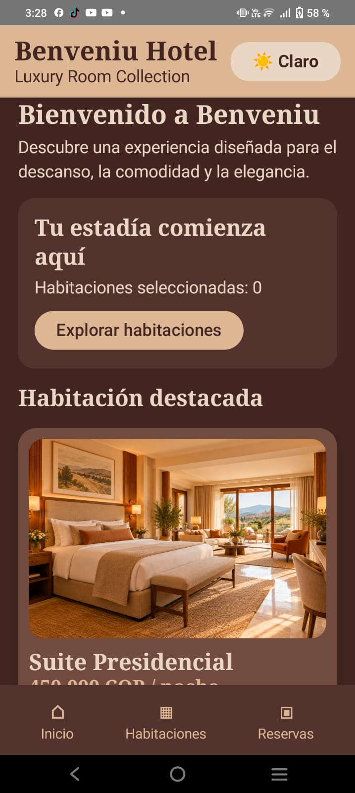
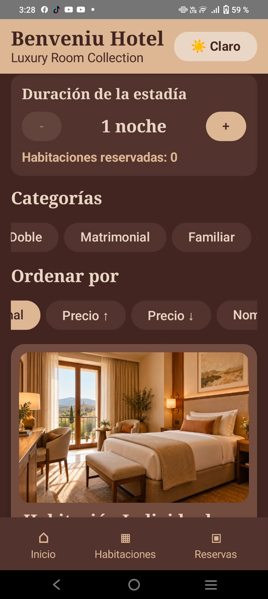
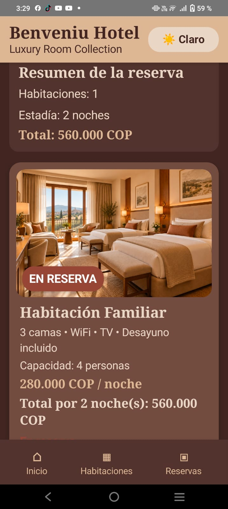
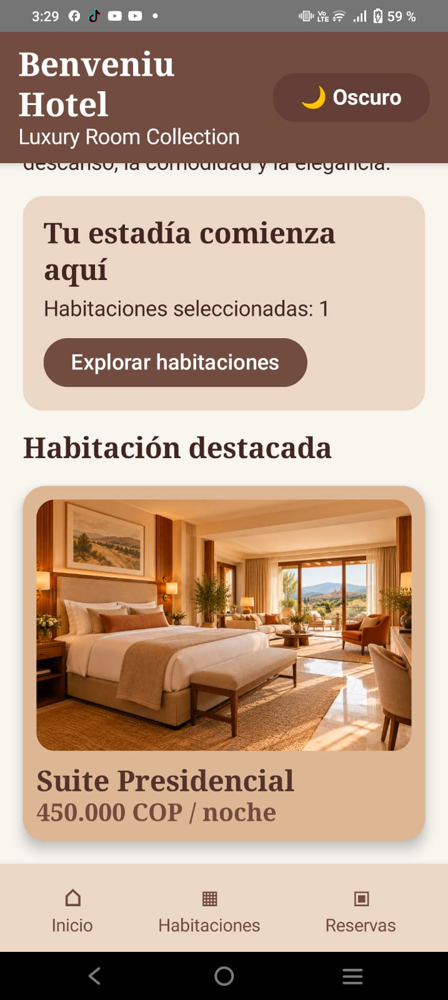

# Benveniu Hotel

Aplicación móvil desarrollada en Kotlin utilizando Jetpack Compose para la asignatura Aplicativos Móviles.

## Descripción del negocio

Benveniu Hotel es una aplicación orientada a la visualización y reserva de habitaciones de hotel.

La aplicación permite al usuario explorar diferentes tipos de habitaciones, seleccionar la duración de su estadía, filtrar y ordenar las habitaciones disponibles, realizar reservas y consultar un resumen con el valor total de la estadía.

La interfaz utiliza una identidad visual inspirada en hoteles modernos y elegantes, con una paleta de colores basada en tonos café, beige y dorado.

---

## Objetivo de la aplicación

Desarrollar una primera versión funcional de una aplicación móvil para un hotel utilizando Kotlin y Jetpack Compose.

La aplicación busca demostrar el uso de:

- Jetpack Compose.
- Material 3.
- Navigation Compose.
- Manejo de estados.
- Eventos.
- LazyColumn y LazyRow.
- Componentes reutilizables.
- Colecciones de datos.
- Temas claro y oscuro.

---

## Pantallas implementadas

La aplicación cuenta con tres pantallas principales.

### 1. Inicio

Pantalla principal de bienvenida al hotel.

Permite:

- Visualizar información general del hotel.
- Consultar la cantidad de habitaciones seleccionadas.
- Ver una habitación destacada.
- Acceder directamente al catálogo de habitaciones.

### 2. Habitaciones

Pantalla principal del catálogo.

Permite:

- Visualizar las habitaciones disponibles.
- Seleccionar la cantidad de noches.
- Filtrar las habitaciones por categoría.
- Ordenar las habitaciones por precio o nombre.
- Consultar precio, capacidad y disponibilidad.
- Reservar o cancelar una habitación.

### 3. Mis Reservas

Pantalla en la que se muestran las habitaciones seleccionadas por el usuario.

Permite:

- Consultar las habitaciones reservadas.
- Visualizar la duración de la estadía.
- Consultar el valor individual de cada habitación.
- Consultar el valor total de la reserva.
- Cancelar habitaciones reservadas.

---

## Habitaciones disponibles

El catálogo incluye las siguientes habitaciones:

1. Habitación Individual.
2. Habitación Doble.
3. Habitación Matrimonial.
4. Habitación Familiar.
5. Suite Junior.
6. Suite Presidencial.

Cada habitación se genera dinámicamente a partir de una colección de objetos de la clase `Habitacion`.

---

## Funcionalidades interactivas

### Funcionalidad trabajada en clase: reservar y cancelar habitaciones

El usuario puede agregar una habitación a sus reservas y posteriormente cancelarla.

El estado de las habitaciones reservadas se almacena utilizando `remember` y `mutableStateOf`.

La interfaz se actualiza automáticamente cuando cambia el estado.

---

### Funcionalidad nueva 1: filtro por categorías

El usuario puede seleccionar una categoría para visualizar únicamente las habitaciones correspondientes.

Las categorías disponibles son:

- Todas.
- Individual.
- Doble.
- Matrimonial.
- Familiar.
- Suites.

La lista se actualiza dinámicamente dependiendo de la categoría seleccionada.

---

### Funcionalidad nueva 2: ordenamiento de habitaciones

El usuario puede modificar el orden en el que aparecen las habitaciones.

Las opciones disponibles son:

- Orden normal.
- Precio de menor a mayor.
- Precio de mayor a menor.
- Nombre.

El ordenamiento se realiza dinámicamente utilizando las funciones de colecciones de Kotlin.

---

## Funcionalidades adicionales

Además de las tres funcionalidades principales, la aplicación incluye:

---

## Capturas de pantalla

A continuación se muestran las principales pantallas de la aplicación Benveniu Hotel.

### Pantalla de inicio

La pantalla principal presenta la identidad del hotel, la habitación destacada y el acceso al catálogo.



### Catálogo de habitaciones

En esta pantalla el usuario puede seleccionar la duración de la estadía, filtrar las habitaciones por categoría y ordenarlas por precio o nombre.



### Mis reservas

La pantalla de reservas muestra las habitaciones seleccionadas, el número de noches y el valor total de la estadía.



### Tema claro

La aplicación permite cambiar manualmente entre tema oscuro y tema claro utilizando el botón ubicado en la barra superior.



---

### Selección de noches

El usuario puede aumentar o disminuir la cantidad de noches de la estadía mediante los botones `+` y `-`.

El precio total de cada habitación se actualiza automáticamente.

### Cálculo automático del total

La aplicación calcula el valor de la habitación mediante:

```kotlin
val total = habitacion.precio * noches