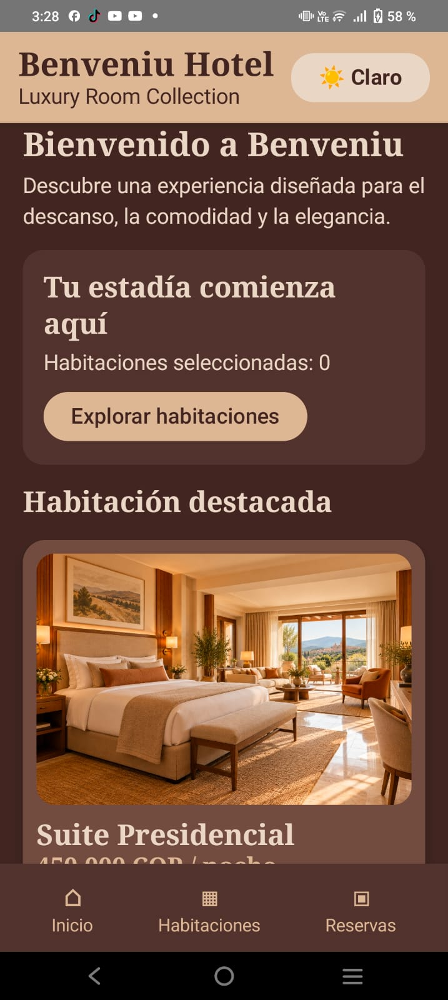
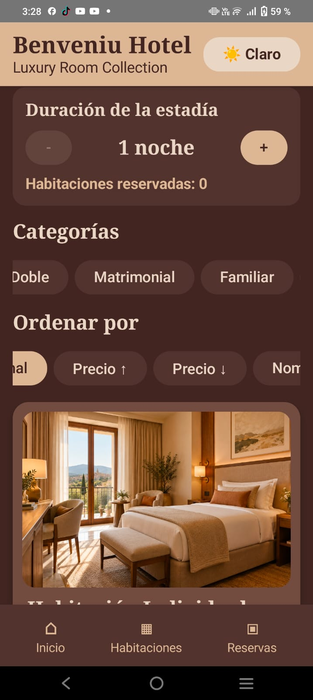
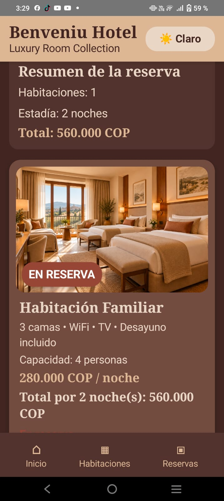
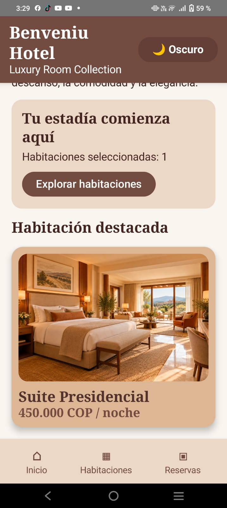

# Benveniu Hotel

Aplicación móvil desarrollada en **Kotlin con Jetpack Compose** para la asignatura **Aplicativos Móviles**.

**Versión:** Segundo corte académico.

## Descripción del proyecto

Benveniu Hotel es una aplicación Android orientada a la consulta de habitaciones y gestión de reservas de un hotel.

Permite explorar seis tipos de habitaciones, consultar sus características y precios, filtrar y ordenar el catálogo, registrar reservas, modificarlas, cancelarlas y consultar su historial.

La aplicación incorpora una base de datos local mediante **Room**, que permite conservar la información de las reservas entre sesiones.

Su interfaz utiliza una identidad visual inspirada en hoteles modernos, con tonos café, beige y dorado.

---

## Objetivo

Desarrollar una aplicación móvil funcional que integre una interfaz moderna con una arquitectura organizada y almacenamiento persistente.

El proyecto evoluciona desde una primera versión basada en estados de Jetpack Compose hasta una segunda versión que incorpora Room, operaciones CRUD y separación de responsabilidades mediante Repository y ViewModel.

## Tecnologías utilizadas

- Kotlin.
- Jetpack Compose.
- Material Design 3.
- Navigation Compose.
- Room y SQLite.
- DAO (Data Access Object).
- Repository.
- ViewModel.
- Flow y StateFlow.
- Gradle.

---

## Pantallas principales

### 1. Inicio

Pantalla de bienvenida que presenta la identidad visual de Benveniu Hotel, información general y acceso al catálogo de habitaciones.

### 2. Habitaciones

Permite consultar las habitaciones disponibles, seleccionar la duración de la estadía, filtrar por categoría y ordenar los resultados.

El catálogo incluye:

1. Habitación Individual.
2. Habitación Doble.
3. Habitación Matrimonial.
4. Habitación Familiar.
5. Suite Junior.
6. Suite Presidencial.

### 3. Mis Reservas

Permite administrar las reservas mediante dos secciones:

**Activas:** muestra las reservas vigentes, sus características y los resúmenes de estadía.

**Historial:** permite consultar las reservas canceladas y eliminarlas cuando corresponda.

---

## Funcionalidades del primer corte

- Catálogo de habitaciones.
- Filtros por categoría.
- Ordenamiento por precio o nombre.
- Selección de noches.
- Cálculo del valor de la estadía.
- Navegación entre pantallas.
- Componentes reutilizables.
- Tema claro y oscuro.

## Funcionalidades del segundo corte

### 1. Registrar reservas

Permite crear una reserva seleccionando una habitación e ingresando los datos solicitados.

### 2. Consultar reservas

Muestra las reservas almacenadas, incluyendo la información del huésped y la estadía.

### 3. Editar reservas

Permite modificar los datos de una reserva existente.

### 4. Eliminar reservas

Permite eliminar registros mediante una acción de eliminación con confirmación.

### 5. Cancelar reservas

Permite cambiar el estado de una reserva activa a cancelada.

### 6. Historial de reservas

Las reservas canceladas pueden consultarse desde la pestaña Historial.

### 7. Persistencia de datos

Las reservas se almacenan mediante Room y permanecen disponibles después de cerrar y volver a abrir la aplicación, mientras se conserven sus datos locales.

---

## Arquitectura del proyecto

La aplicación utiliza una organización basada en capas.

### Capa de datos

**Entidades:**
- `HabitacionEntity.kt`
- `ReservaEntity.kt`

**Acceso a datos:**
- `HabitacionDao.kt`
- `ReservaDao.kt`

**Base de datos:**
- `HotelDatabase.kt`

**Repositorio:**
- `HotelRepository.kt`

### Lógica y estado

`HotelViewModel.kt` conecta la interfaz con las operaciones de datos y gestiona el estado utilizado por las pantallas.

### Interfaz de usuario

La interfaz está desarrollada mediante Jetpack Compose, con componentes y navegación adaptados a las funcionalidades del hotel.

---

## Instrucciones de instalación

### Requisitos

- Android Studio.
- Android SDK.
- Dispositivo Android compatible con API 24 o superior.

### Generar el APK

Desde la raíz del proyecto, ejecutar en Windows:

```powershell
.\gradlew.bat assembleDebug
```

El APK generado se encuentra normalmente en:

```text
app/build/outputs/apk/debug/app-debug.apk
```

Transferir el archivo al dispositivo Android e instalarlo siguiendo las indicaciones del sistema.

El APK de depuración está destinado a pruebas académicas, no a distribución mediante Google Play.

---

## Pasos para probar la aplicación

1. Abrir Benveniu Hotel.
2. Acceder al catálogo de habitaciones.
3. Aplicar filtros y cambiar el ordenamiento.
4. Seleccionar una habitación y registrar una reserva.
5. Entrar en Mis Reservas y comprobar que aparece en Activas.
6. Editar la reserva y verificar que se actualizan sus datos.
7. Cerrar completamente la aplicación y volver a abrirla.
8. Confirmar que la reserva continúa almacenada.
9. Cancelar la reserva y comprobar que aparece en Historial.
10. Eliminar una reserva y verificar que desaparece de la lista correspondiente.

---

## Capturas de pantalla

### Inicio



### Catálogo de habitaciones



### Mis Reservas



### Tema claro



Las capturas corresponden a la documentación visual del proyecto y pueden actualizarse para reflejar la interfaz del segundo corte.

---

## Repositorio

[Benveniu Hotel — GitHub](https://github.com/Samuel-Tovar/benveniu-hotel-catalog)

## Contexto académico

Proyecto desarrollado para la asignatura **Aplicativos Móviles**, como evolución de la aplicación presentada en el primer corte.

La segunda entrega incorpora arquitectura de datos, persistencia local y gestión de reservas mediante operaciones CRUD.